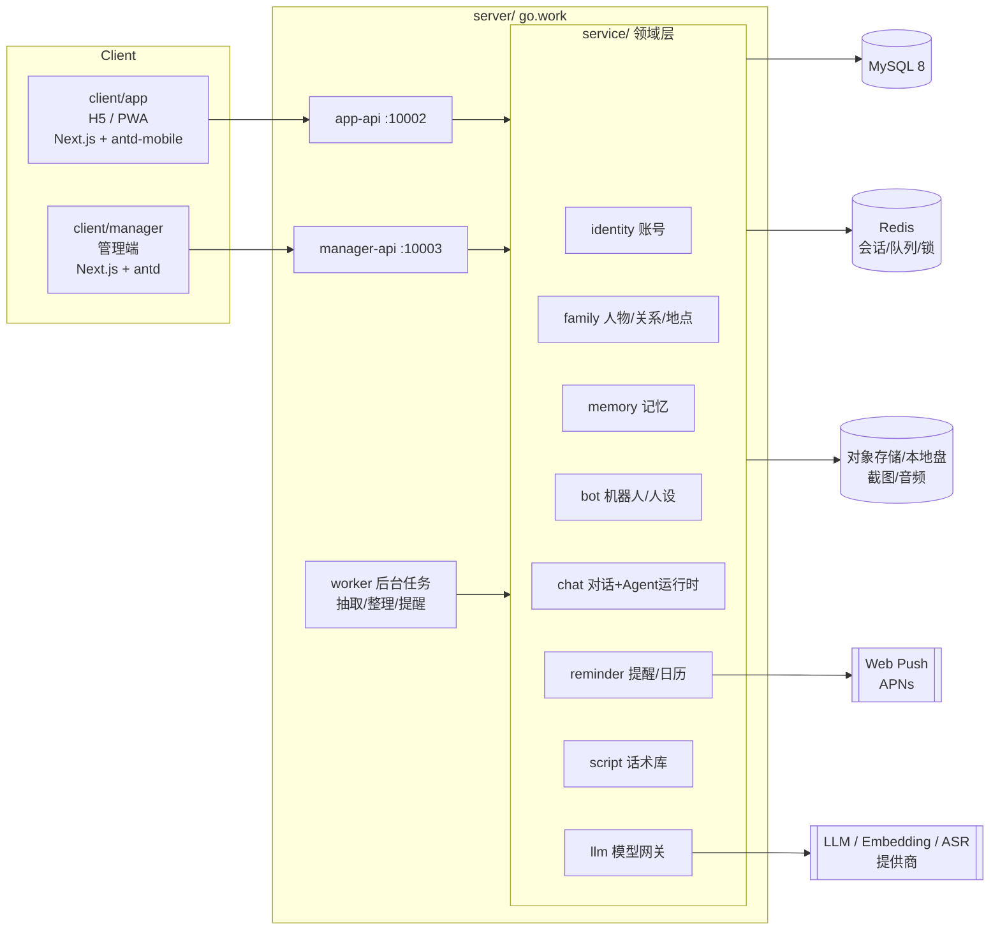
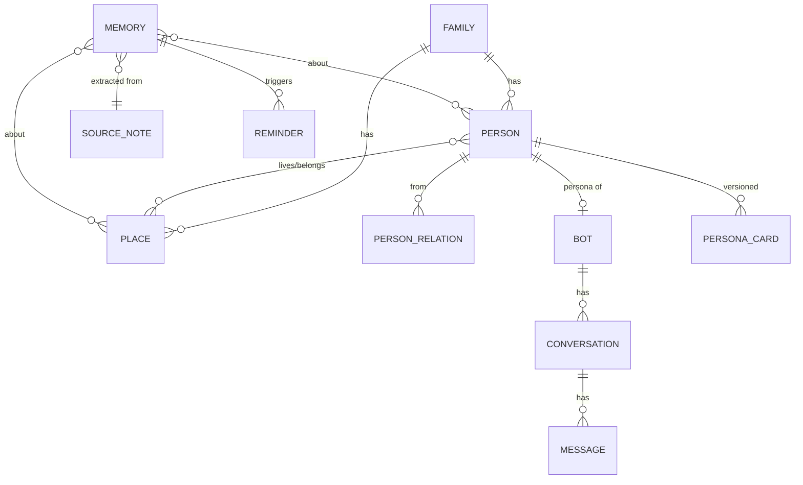
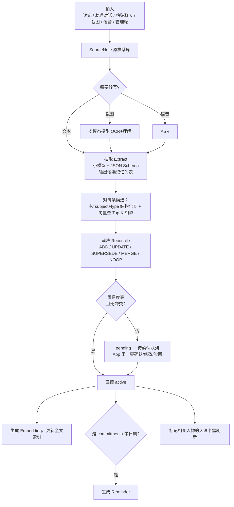

# 家庭关系助理（private_assistant）总体设计

> 版本：v0.1（初稿） · 日期：2026-10-07
> 参考工程：`../universe`（go.work 多模块 + Next.js 双前端）

---

## 0. 一句话定位

一个**只给我自己用**的「家庭关系外脑」：
1. **记得住**——老婆、妈妈、女儿说过的话、在意的事、习惯和变化，以及三个家（上海 / 我爸妈老家 / 岳父母老家）的人情关系和规矩，我忘了它不能忘；
2. **想得到**——在该提醒的时候主动提醒（生日、承诺、回老家之前）；
3. **说得对**——遇到具体的事，基于这些记忆给我可执行的建议和话术，而不是空泛的道理。

### 目标
| 编号 | 目标 | 衡量方式 |
|---|---|---|
| G1 | 录入成本足够低，手机上 10 秒内能记下一句话 | 速记入口 → 提交 ≤ 2 次点击 |
| G2 | 「她以前说过」类问题能答出来，并给出原话、时间、出处 | 问答带引用 |
| G3 | 关键日期 / 承诺 / 出行前有主动提醒 | Web Push 到 iPhone |
| G4 | 关系建议具体、贴合这家人，而不是通用鸡汤 | 每条建议引用到具体记忆；我可以打分纠正 |
| G5 | 人的性格习惯会变，系统能记录「变化」而不是覆盖 | 记忆带有效期和替代链 |

### 非目标（第一阶段明确不做）
- 不给老婆 / 妈妈本人使用，不做多家庭 SaaS；
- 不接入微信自动抓取聊天（合规与风控成本高），只支持我手动粘贴 / 截图导入；
- 不做心理诊断。超出「沟通建议」范畴的情况，助理应建议专业的婚姻家庭咨询。

---

## 1. 总体架构



### 1.1 技术选型

| 组件 | 选型 | 说明 |
|---|---|---|
| 后端 | Go 1.22+，Gin，GORM，go.work 多模块 | 与 universe 一致，复用 `httpx` / `db.Repository[T]` / `routers.Handler` 这套 |
| 主存储 | MySQL 8 | 所有结构化数据 + 记忆正文 + 向量（BLOB） |
| 向量检索 | **v1：Go 进程内暴力余弦**；预留 `VectorIndex` 接口，后续可换 Qdrant | 一个家庭的记忆量级是千到万条，1 万条 × 1024 维 ≈ 40MB，内存全量算余弦 < 10ms，不值得再多运维一个组件 |
| 中文全文 | MySQL FULLTEXT + `ngram` parser | 和向量做混合检索，专门兜「原话里的关键词」 |
| 缓存/队列 | Redis（会话令牌、异步任务队列、分布式锁） | universe 已有 `redisqueue` 可复用 |
| 管理端前端 | Next.js 14 + antd 5 | 与 universe/client/manager 一致 |
| 用户端前端 | Next.js 14 + **antd-mobile 5**（建议）+ PWA | antd 是桌面组件库，手机上体验差；antd-mobile 是同一生态的移动版，更接近 App 手感。共享 `client/shared` 的 api/auth |
| 流式输出 | SSE（`text/event-stream`） | iOS Safari / PWA 兼容性好，比 WebSocket 简单 |
| 推送 | Web Push（VAPID） | iOS 16.4+ 在「添加到主屏幕」后支持 |
| 农历 | `github.com/6tail/lunar-go` | 老家亲戚生日、节日基本按农历 |

### 1.2 工程目录

```
private_assistant/
├── doc/                         # 设计 & 需求文档
├── server/
│   ├── go.work
│   ├── contract/                # 跨领域的数据形状（唯一共享类型）
│   ├── common/
│   │   └── middleware/{httpx,db,routers,auth}
│   ├── service/                 # 领域层，领域包之间禁止互相 import，用 ports.go 注入
│   │   ├── identity/            # 管理员/用户账号、登录、令牌
│   │   ├── family/              # 人物、关系图、地点、习俗
│   │   ├── memory/              # 记忆：写入管线、检索、整理、人设卡
│   │   ├── bot/                 # 机器人定义、Prompt 模板、版本
│   │   ├── chat/                # 会话、消息、Agent 循环、工具注册
│   │   ├── reminder/            # 提醒、日历（含农历）、推送
│   │   ├── script/              # 话术库、反馈样本
│   │   └── llm/                 # 模型网关：多提供商、路由、计费日志
│   ├── manager-api/             # 管理端 HTTP（:10003）
│   ├── app-api/                 # 用户端 HTTP（:10002）
│   ├── worker/                  # 后台任务进程（v1 可内嵌到 app-api 里跑）
│   ├── migrations/
│   └── compose.yaml
└── client/
    ├── shared/                  # api client、auth、类型
    ├── manager/                 # 管理端
    └── app/                     # 用户端 PWA
```

分层规则直接沿用 universe：
- `*-api/pkg/{子域}/handler.go`：只做绑参 → 调 service → `httpx.JSON`；
- `service/{domain}`：Service 接口 + 实现，返回 DTO；
- `service/{domain}/internal/repository`：Entity + 查询，Go `internal` 保护单写；
- 跨领域依赖：在调用方的 `ports.go` 里声明最小接口，由 `main.go` 注入（例如 `chat` 需要 `memory.Search`，就在 `chat/ports.go` 声明 `MemorySearcher`）。

---

## 2. 领域模型



### 2.1 人物（Person）

家里的每个人、两边老家的每个亲戚都是一个 Person。核心是三个「有分身」的人：老婆、妈妈、女儿，和「我」自己。

| 字段 | 说明 |
|---|---|
| `person_key` | 业务键，如 `wife`、`mom`、`daughter`、`me`、`wife_father` |
| `name` / `nickname` | 真名 / 家里怎么叫 |
| `gender`, `birthday`, `birthday_calendar` | 生日 + 公历/农历 |
| `home_place_key` | 所属的家（地点） |
| `side` | 归属哪一边：`self`（我家）/ `wife_side`（老婆娘家）/ `core`（核心小家） |
| `importance` | 1-5，决定检索和简报的优先级 |
| `avatar` | 头像 |

### 2.2 关系图（PersonRelation）

**这是解决「老家亲戚关系处理不好」的关键数据。** 不是只记「他是谁」，而是记「我该怎么对待他」。

| 字段 | 说明 |
|---|---|
| `from_person`, `to_person` | 有向边 |
| `relation` | 父亲、舅舅、表姐、堂弟…… |
| `address_as` | **我应该怎么称呼他**（以及女儿该怎么叫） |
| `closeness` | 亲疏 1-5 |
| `notes` | 关系要点：「大舅当年借钱给岳父开店，岳父很念这个情」 |
| `sensitivities` | 雷区：「不要在二姨面前提她儿子离婚」 |

关系图在管理端用图可视化（antd + `@antv/g6`），用户端以「这个人是谁」卡片形式查看。

### 2.3 地点（Place）与习俗（Custom）

三个家：`home_shanghai`、`home_my_parents`、`home_wife_parents`。

| 字段 | 说明 |
|---|---|
| `place_key`, `name`, `address`, `dialect` | 基本信息 |
| `members` | 常住的人 |
| `customs` | **规矩**：过年初几去谁家、红包标准、上桌座次、送礼禁忌、谁家先拜年 |
| `travel_tips` | 去之前要准备什么 |

> 习俗本身也是一类记忆（见 3.2 的 `custom` 类型），这里的 `customs` 只是按地点聚合的视图。

### 2.4 机器人（Bot）

| bot_key | 类型 | 绑定人物 | 能看到的记忆 | 主要用途 |
|---|---|---|---|---|
| `wife` | persona | 老婆 | 老婆相关 + 公共 | 了解她的视角；预演对话（「我这么说她会怎么想」） |
| `mom` | persona | 妈妈 | 妈妈相关 + 公共 | 同上 |
| `daughter` | persona | 女儿 | 女儿相关 + 公共 | 了解孩子当前阶段的需求、偏好；陪我想怎么带娃 |
| `assistant` | assistant | — | **全部** | 主入口：记录、问答、出主意、复盘、简报 |

每个 Bot 的配置：模型路由、系统 Prompt 模板（版本化）、可用工具清单、温度、记忆可见范围、开场白。

---

## 3. 记忆系统（核心）

### 3.1 设计原则

1. **原始记录不可变，记忆可演化。** 我录入的每一句原话、粘贴的每一段聊天都先作为 `SourceNote` 原样落库，永不修改；LLM 从中抽取出的「记忆」可以被更新、合并、废弃，但永远能追溯回原话。——「她说过的话」必须拿得出原文。
2. **变化是一等公民。** 性格、习惯、偏好不覆盖，而是「旧的到期，新的生效」，保留演化轨迹（例：「2025 年她喜欢周末出去玩 → 2026 年 6 月起更想周末在家休息」）。
3. **结构化 + 语义化双轨。** 能结构化的（生日、称呼、过敏、承诺截止日）走字段，查得准；说不清的（感受、事件、观点）走文本 + 向量，查得全。
4. **人审兜底。** 模型抽取有错。低置信度或与已有记忆冲突的，进「待确认」队列，我在手机上一划确认/驳回。
5. **按人隔离可见范围。** 分身只能看到「关于她自己 + 公共」的记忆，保证人设不串；助理看全部。

### 3.2 记忆类型

| type | 名称 | 例子 | 关键结构化字段 |
|---|---|---|---|
| `trait` | 性格特质 | 老婆：自尊心强，被当众否定会很难受 | `aspect` |
| `habit` | 生活习惯 | 妈妈：每天 5 点半起床，习惯先烧开水 | `aspect`, `time_pattern` |
| `preference` | 喜好/厌恶 | 女儿：不吃胡萝卜，最近爱吃玉米 | `polarity`(like/dislike), `category`(饮食/玩具/...) |
| `quote` | **原话** | 老婆 9/20：「你妈每次当着孩子面说我，我真的受不了」 | `speaker`, `said_at`, `verbatim`, `context` |
| `need` | 诉求/在意的事 | 老婆希望我在婆媳分歧时私下先站她这边，再去和妈沟通 | `status`(open/addressed) |
| `commitment` | **我的承诺** | 答应老婆国庆后带她去杭州 | `promised_to`, `due_at`, `status` |
| `event` | 事件经过 | 9/20 晚饭，妈妈说孩子穿少了，老婆不高兴 | `occurred_at`, `participants`, `emotion`, `resolution` |
| `conflict` | 矛盾点 | 婆媳在「孩子吃零食」上的分歧 | `parties`, `topic`, `positions`, `status` |
| `taboo` | 雷区 | 不要拿老婆和嫂子比较 | `severity` |
| `custom` | 规矩习俗 | 岳父母老家：初二回娘家，给长辈红包 1000 起 | `place_key`, `occasion` |
| `routine` | 孩子作息/学习 | 女儿 20:30 洗澡，21:00 讲故事睡觉 | `time_pattern` |
| `health` | 健康 | 女儿对芒果过敏 | `severity` |
| `milestone` | 成长节点 | 女儿 2026/9 开始上幼儿园中班 | `occurred_at` |
| `insight` | 归纳洞察（系统生成） | 老婆近一个月最在意：1)被尊重 2)…… | `period`, `derived_from[]` |

### 3.3 记忆表结构（`pa_memory`）

```sql
CREATE TABLE pa_memory (
  id              BIGINT PRIMARY KEY AUTO_INCREMENT,
  memory_key      VARCHAR(40)  NOT NULL UNIQUE,      -- 业务键 mem_xxx
  family_key      VARCHAR(40)  NOT NULL,
  type            VARCHAR(20)  NOT NULL,             -- 见 3.2
  scope           VARCHAR(20)  NOT NULL,             -- person / shared / place / relation
  subject_person  VARCHAR(40)  NULL,                 -- 主要关于谁
  title           VARCHAR(200) NOT NULL,             -- 一句话摘要，列表/提示词里用
  content         TEXT         NOT NULL,             -- 完整描述
  attrs           JSON         NULL,                 -- 类型相关的结构化字段
  importance      TINYINT      NOT NULL DEFAULT 3,   -- 1-5
  confidence      DECIMAL(3,2) NOT NULL DEFAULT 1.0, -- 抽取置信度，人工录入=1
  status          VARCHAR(20)  NOT NULL,             -- pending / active / superseded / archived / rejected
  valid_from      DATETIME     NULL,                 -- 从什么时候开始成立
  valid_to        DATETIME     NULL,                 -- 什么时候不再成立（变化）
  supersedes_key  VARCHAR(40)  NULL,                 -- 替代了哪条旧记忆
  source_note_key VARCHAR(40)  NULL,                 -- 来自哪条原始记录
  created_by      VARCHAR(20)  NOT NULL,             -- manual / extract / reflect
  last_used_at    DATETIME     NULL,                 -- 最近被检索命中（用于排序和清理）
  use_count       INT          NOT NULL DEFAULT 0,
  created_at, updated_at,
  FULLTEXT KEY ft_title_content (title, content) WITH PARSER ngram,
  KEY idx_family_subject_type (family_key, subject_person, type, status)
);

CREATE TABLE pa_memory_link (          -- 一条记忆关联多个人/地点
  memory_key VARCHAR(40), target_type VARCHAR(10), target_key VARCHAR(40), role VARCHAR(20),
  PRIMARY KEY (memory_key, target_type, target_key)
);

CREATE TABLE pa_memory_embedding (
  memory_key VARCHAR(40) PRIMARY KEY, model VARCHAR(60), dim INT, vector BLOB, updated_at DATETIME
);

CREATE TABLE pa_source_note (          -- 原始记录，只增不改
  note_key VARCHAR(40) PRIMARY KEY, family_key VARCHAR(40),
  channel  VARCHAR(20),                -- quick_note / chat / paste / screenshot / voice / manager
  raw_text MEDIUMTEXT, attachments JSON, about_persons JSON,
  occurred_at DATETIME,                -- 事情发生的时间（不是录入时间）
  extract_status VARCHAR(20), created_at DATETIME
);
```

### 3.4 写入管线



**抽取（Extract）**：用便宜的模型（如 Haiku 4.5）+ 严格 JSON Schema 输出，提示词里给出：已知人物列表（含别名，比如「她」默认指老婆、「老太太」指妈妈）、记忆类型定义、当前日期（把「下周三」换算成绝对日期）。

**裁决（Reconcile）**：参考 mem0 的思路，把候选记忆和检索到的旧记忆一起交给模型，让它输出操作：

| 操作 | 场景 |
|---|---|
| `ADD` | 全新信息 |
| `UPDATE` | 同一事实补充细节（不改变含义） |
| `SUPERSEDE` | **事实变了**：旧记忆 `valid_to=now, status=superseded`，新记忆 `supersedes_key=旧` |
| `MERGE` | 多条重复说法合并为一条 |
| `NOOP` | 已知，只给旧记忆加一条来源引用 |

`SUPERSEDE` 一律进待确认队列——「她变了」这种判断必须由我拍板。

### 3.5 读取 / 检索

助理和分身回答前，上下文由三层组成：

| 层 | 内容 | 来源 | 大小 |
|---|---|---|---|
| **L1 常驻** | 人设卡（性格、说话方式、当前最在意的事、雷区 Top N）+ 我的未完成承诺 + 近 7 天重要事件 | `PersonaCard` + 结构化查询 | ~1.5k tokens，放系统提示词，**开 prompt cache** |
| **L2 自动召回** | 与当前问题相关的记忆 | 混合检索（下表） | Top 15–30 条，~3k tokens |
| **L3 按需** | 模型自己调用工具去查 | 工具调用（3.7） | 不限 |

**混合检索打分：**
```
score = 0.45 * 向量相似度
      + 0.20 * 全文 BM25（归一化）
      + 0.15 * importance/5
      + 0.10 * 时间新鲜度  exp(-Δdays / 半衰期)   # quote/event 半衰期 90 天；trait/custom 不衰减
      + 0.10 * 人物命中（问题里提到的人 = 记忆关联的人）
过滤：status=active，且 (valid_to IS NULL OR valid_to > now)，且在该 Bot 的可见范围内
```
问「她以前是怎么想的」这类时间问题时，放开 `superseded` 的过滤，让模型能看到演化轨迹。

**注入格式**（每条带出处，便于模型引用、也便于我核对）：
```
[mem_8f2a | 原话 | 老婆 | 2026-09-20 | 重要度4]
「你妈每次当着孩子面说我，我真的受不了」—— 起因：妈妈说孩子穿少了
```

### 3.6 整理与反思（后台定时）

| 任务 | 频率 | 做什么 |
|---|---|---|
| 人设卡刷新 `PersonaCard` | 有新记忆的人，每晚 | 用强模型基于该人全部 active 记忆重写人设卡，**存新版本**并生成和上一版的 diff（「新增：最近对孩子的教育焦虑上升」），管理端可审阅/回滚 |
| 洞察 `insight` | 每周 | 「这周老婆最在意的 3 件事」「婆媳之间仍未解决的矛盾」「我还欠着的承诺」 |
| 去重合并 | 每周 | 向量相似度 > 0.92 的同类记忆提给模型判断是否合并 |
| 过期检查 | 每天 | 承诺到期未完成、`need` 长期 open 的，生成提醒 |

### 3.7 Agent 工具（给助理和分身用）

| 工具 | 说明 | 助理 | 分身 |
|---|---|---|---|
| `search_memory(query, persons?, types?, time_range?, include_history?)` | 混合检索 | ✅ | ✅（限可见范围） |
| `get_person(person_key)` | 人物档案 + 人设卡 + 和我的关系 | ✅ | 仅自己 |
| `get_relations(person_key, depth)` | 社会关系、称呼、雷区 | ✅ | ✅ |
| `get_place(place_key)` | 地点 + 习俗 + 常住人员 | ✅ | ✅ |
| `list_commitments(status)` | 我的承诺 | ✅ | ❌ |
| `list_upcoming(days)` | 近期生日、纪念日、节日、提醒（含农历换算） | ✅ | ❌ |
| `propose_memory(...)` | 把对话里的新信息记下来（走写入管线，必要时进待确认） | ✅ | ❌ |
| `create_reminder(...)` | 建提醒 | ✅ | ❌ |
| `search_scripts(scenario)` | 查话术库里的好/坏示例 | ✅ | ❌ |
| `ask_persona(bot_key, message)` | 助理内部「问一下老婆分身她会怎么反应」 | ✅ | ❌ |
| `now()` | 当前时间、星期、农历 | ✅ | ✅ |

Agent 循环在 Go 里自己实现（`service/chat/agent`）：最多 8 轮工具调用，工具调用和结果都落 `pa_message`，前端可折叠展示「查了哪些记忆」。

---

## 4. 机器人设计

### 4.1 私人助理（主入口）

助理承担 5 种模式，由模型根据输入自动判断，App 也提供快捷入口：

| 模式 | 触发 | 输出 |
|---|---|---|
| **记录** | 「记一下：老婆说下个月 15 号她闺蜜结婚」 | 确认记下的内容 + 是否建提醒 |
| **问答** | 「她上次说想去哪玩来着？」 | 答案 + 原话引用 + 时间 |
| **出主意** | 「我妈又说她惯孩子，她现在在生气，我怎么办」 | 见下方结构 |
| **复盘** | 「今天吵架了，经过是……」 | 记录事件 + 分析各方需要 + 下次怎么做 |
| **简报** | 每天早上 / 回老家前 / 节日前 | 今天要注意的事、待办承诺、相关人物要点 |

**「出主意」的固定输出结构**（写进系统提示词，也是话术训练的标准格式）：
1. **先稳住**：此刻最该做/最不该做的一件事（一句话）；
2. **她真正在意的**：基于记忆分析老婆（和妈妈）此刻的感受和需要，引用具体记忆；
3. **可以这样说**：2–3 句可以直接说出口的话术；
4. **千万别说**：容易踩雷的说法，及原因；
5. **之后要做的**：后续行动（可一键转承诺/提醒）。

**助理的立场准则**（系统提示词硬约束）：
- 不评判谁对谁错，不贬低任何家人；目标是让每个人感到被尊重；
- 承认我的责任，但给出的是「能做的动作」而不是批评；
- 只基于记忆说话，记忆里没有的就说「不确定」，并建议我去问 / 去观察；
- 出现严重信号（持续冷战、提离婚、家暴、抑郁倾向）时，明确建议寻求专业婚姻家庭咨询或相关帮助。

### 4.2 分身（老婆 / 妈妈 / 女儿）

分身的系统提示词 = 模板 + 人设卡 + 近期状态 + 检索到的记忆：
```
你在模拟 {name}（{relation}）的视角，帮助 {me} 理解她。
【人设卡 v{n}，更新于 {date}】{persona_card}
【她最近的状态】{recent_events / open needs}
【相关记忆】{retrieved}
规则：
- 用她的说话方式回应，但不编造记忆里没有的具体事实；
- 当信息不足时，跳出角色说明「我（模拟）不确定她会怎么想，建议……」；
- 你是模拟，不是她本人。
```

典型用法：
- **预演**：「我想这样跟你说：……你会怎么想？」→ 分身回应 + （可选）助理点评；
- **换位**：「你为什么对妈妈说的那句话那么在意？」
- **女儿分身**：3 岁半的孩子说不清楚，这个分身更偏向「育儿视角的女儿档案」——饮食、作息、最近喜欢什么、上幼儿园适应情况、怎么哄她睡觉，回答以「爸爸可以这样做」为主，而不是让模型装成小孩说话。

> ⚠️ 分身永远只是**近似**。系统里所有分身对话都标注「模拟」，助理的建议也会提醒：最终以和真人沟通为准。

### 4.3 话术训练（Script）

「训练」不是微调模型，而是**维护一个高质量的示例库 + 反馈闭环**，在推理时作为 few-shot 注入：

| 表 `pa_script` 字段 | 说明 |
|---|---|
| `scenario` | 场景：婆媳分歧 / 老婆抱怨我不关心 / 回老家亲戚问收入 / 孩子哭闹…… |
| `situation` | 具体情况描述 |
| `good_response` | 好的说法 |
| `bad_response` | 反面示例 + 为什么不好 |
| `principles` | 背后原则（如「先共情再讲事实」） |
| `applies_to` | 适用的人（老婆/妈妈/岳父母…） |
| `source` | 人工编写 / 从对话反馈沉淀 |

**反馈闭环**：App 里每条助理回复都可以 👍 / 👎 / 「我实际是这么说的，结果……」。
- 👎 + 修正 → 生成一条待审核的 Script；
- 「结果很好/很差」→ 作为 `event` 记忆存下，下次同类场景检索得到。

---

## 5. 提醒与日历

| 来源 | 例子 |
|---|---|
| 人物生日（公历/农历）、纪念日 | 结婚纪念日、岳母农历生日、女儿生日 |
| 承诺 `commitment.due_at` | 「国庆后带老婆去杭州」 |
| 带日期的 `quote`/`need` | 「老婆说下个月 15 号闺蜜结婚」 |
| 传统节日 × 地点习俗 | 春节前 14 天：「今年在哪过年？两边老家规矩回顾 + 红包预算」 |
| 出行（我在 App 里建一个「回老家」行程） | 出发前 2 天推送**回老家简报** |
| 后台洞察 | 「老婆提的『周末陪孩子』这个诉求已经 3 周没有落实」 |

**回老家简报示例结构**：
1. 这次会见到谁（按关系图），每人：称呼、上次见面聊过什么、近况、雷区；
2. 这边的规矩（座次、红包、送礼）；
3. 老婆上次回来后对这边**提过的不满**（原话）——这次要避免；
4. 老婆这次可能需要我做的事（例如：替她挡掉亲戚关于二胎的追问）。

推送链路：`reminder` 定时扫描（Redis 分布式锁防重） → Web Push（VAPID） → iPhone 主屏 PWA 通知 → 点击直达对应会话/简报。

---

## 6. 前端

### 6.1 用户端 App（`client/app`，H5 / PWA）

**目标体验：从 iPhone 主屏打开，看起来和用起来都像原生 App。**

页面结构（底部 Tab 4 个）：

| Tab | 内容 |
|---|---|
| **对话** | 4 个机器人的会话列表；聊天页支持流式输出、工具调用折叠展示、引用的记忆可点开、每条回复 👍👎 |
| **速记**（中间大按钮） | 一个输入框 + 「关于谁」快捷标签（老婆/妈妈/女儿/亲戚）+ 「什么时候发生」，支持粘贴长文本/截图/语音，提交即走，抽取在后台完成 |
| **今天** | 今日简报、即将到来的提醒、未完成承诺、**待确认记忆**（卡片左滑驳回、右滑确认） |
| **家人** | 人物卡片、关系图（简化版）、三个家的习俗 |

iOS PWA 要点清单：
- `manifest.webmanifest`：`display: standalone`、`start_url`、图标；`apple-touch-icon` 180×180；
- `<meta name="viewport" content="width=device-width, initial-scale=1, viewport-fit=cover">`，布局用 `env(safe-area-inset-*)` 适配刘海和 Home 条；
- 高度用 `100dvh`，聊天输入框处理键盘弹起（`visualViewport` 监听）；
- 禁用双击缩放、长按选中（输入区域除外），`overscroll-behavior: none`；
- Service Worker：静态资源缓存、离线页、**速记离线排队**（IndexedDB，恢复网络后补发）；
- Web Push：必须在「已添加到主屏幕」后由用户手势触发授权（iOS 16.4+）；
- 主屏 PWA 的存储与 Safari 隔离：登录令牌用长效 refresh token（如 90 天），避免频繁重新登录；
- 语音：主屏 PWA 下 Web Speech API 不可靠，v1 直接用 iOS 键盘自带听写；v2 再做「录音上传 → 服务端 ASR」；
- 必须 HTTPS（PWA 和推送都要求）。

### 6.2 管理端（`client/manager`，桌面 Web）

| 菜单 | 功能 |
|---|---|
| 登录 / 账号 | 管理员账号、登录记录（复用 universe 的 Redis 令牌 + 登录失败闸） |
| 用户 | App 用户（现在只有我；预留） |
| 家庭档案 | 人物、关系图（可视化编辑）、地点与习俗 |
| 记忆 | 列表（按人/类型/状态/时间过滤）、详情（来源原话、替代链、被哪些对话引用）、手工新增/编辑/合并、**待确认队列**、时间线视图 |
| 人设卡 | 每人的版本历史、版本 diff、手工修订、回滚 |
| 机器人 | Bot 配置：模型、温度、工具开关、可见范围、Prompt 模板（版本化 + 在线试聊） |
| 话术库 | 场景分类、增删改、来自反馈的待审核条目 |
| 对话 | 所有会话回看，可查看每轮注入的上下文、工具调用、token 消耗 |
| 提醒 | 提醒规则、日历视图、推送记录 |
| 模型 | 提供商与 Key 管理、模型路由（哪个任务用哪个模型）、调用日志与费用统计 |

---

## 7. LLM 网关（`service/llm`）

- **多提供商**：Anthropic（Claude）+ OpenAI 兼容协议（覆盖 DeepSeek、通义千问、豆包等国内模型），统一成一个 `ChatModel` 接口，支持工具调用和流式。
- **按任务路由**（管理端可配）：

| 任务 | 建议模型 | 理由 |
|---|---|---|
| 助理对话 / 出主意 / 复盘 | `claude-opus-5-5` 或 `claude-sonnet-5-5` | 需要细腻的共情和推理 |
| 分身对话 | `claude-sonnet-5-5` | 角色一致性 |
| 记忆抽取 / 裁决 / 分类 | `claude-haiku-4-5-20251001` 或国内小模型 | 量大、结构化输出 |
| 人设卡 / 周洞察 | `claude-opus-5-5` | 一天一次，质量优先 |
| Embedding | 中文效果好的模型（如 bge-m3 / text-embedding-v3 / Voyage） | Anthropic 不提供 embedding；**向量必须记录 model，换模型要全量重算** |
| 截图理解 | 支持图像输入的 Claude 模型 | 微信聊天截图 |

- **Prompt Cache**：系统提示词 + L1 常驻上下文放前面并打 cache 标记，降低多轮对话成本。
- **调用日志** `pa_llm_call`：任务类型、模型、输入/输出 token、耗时、费用、关联会话，便于排查「它为什么这么回答」。
- **网络**：在国内服务器上访问海外 API 需要稳定出口，提供商配置里支持 `base_url` 和代理；国内模型作为降级通道。

---

## 8. 安全与隐私

这套系统里是**整个家庭最私密的信息**，安全按「泄露了会出大事」的标准来做：

1. **部署**：自有服务器 / 家里 NAS，HTTPS；管理端不暴露公网（内网 / VPN / IP 白名单）；
2. **账号**：管理端与 App 独立账号体系；登录失败闸；App 支持 Face ID 级别的二次锁（PWA 里用 WebAuthn/Passkey 解锁）；
3. **数据加密**：数据库磁盘加密；`raw_text`、`content` 等敏感字段可选应用层 AES-GCM 加密（密钥不入库），代价是 FULLTEXT 失效——v1 先做磁盘加密 + 备份加密；
4. **备份**：每日加密备份到异地；
5. **模型提供商**：选择承诺 API 数据不用于训练的提供商；管理端可查看每次发出去的完整上下文；
6. **伦理边界**：分身是为了**更理解家人**，不是为了操纵。系统不提供「怎么让她听我的」这类策略。另外建议在合适的时候，让老婆知道我在用这样的方式努力记住她说的话——这本身可能就是她想看到的「在意」。

### 8.1 老婆知情，未来可能一起用（2026-10-08 确认）

**现在就按「她随时可能看到」来写内容**，这是零成本、马上生效的约束：

- 记忆、人设卡、手册、分身的话，都写成她看了也能接受的样子：描述事实和感受，不贴标签、不挖苦（「她自尊心强，被当众否定会难受」可以；「她太敏感」不行）。现有提示词和手册已经是这个口径，改写手册（06 · 4）和周洞察的提示词也要求不评判。
- 关于我妈的记忆同理：她以后看到的内容里，不能有让婆媳关系更糟的说法。

**她真的来用时要做的（现在不做，结构上已留好口子）**：

| 要做的 | 现状 / 留好的口子 |
|---|---|
| 她的独立账号 | App 账号已经按 `account_key` 区分，对话列表按账号过滤，各自的对话互相看不到 |
| 她自己的助理 | 机器人是数据（`pa_bot`），新增一个「她的助理」并设定立场即可；不应给她开「老婆分身」 |
| 记忆的可见范围 | 现在全家共享一套记忆。到时要加「仅自己可见」：我对她的抱怨、准备怎么和她谈的草稿，默认只有我看得到；她记下的关于我的事，同理 |
| 人设卡 | 她能看到自己的人设卡和「TA 的变化」时间线——这本身可以是沟通的入口，但要先让她知道有这张卡 |
| 我妈的数据 | 她看到「妈妈」的记忆和分身前，要先想清楚边界：建议默认不给她看我妈的分身 |
| 对话学习 | 她的对话里「她说的话」也会被抽成记忆，抽取提示词要按说话人区分（现在只认「我」） |

到那一步再单独写一篇设计，核心是**按账号的记忆可见范围**和**每个账号自己的「我」**。

---

## 9. 典型场景走查

**场景 A：她说过的话**
> 周三晚，老婆随口说：「我妈下个月过生日，想让你今年别再忘了。」
1. 我在 App 速记：「老婆：我妈下个月生日，别再忘了」，关于=老婆、岳母；
2. 抽取：`quote`（老婆原话）+ `need`（希望我记得岳母生日）；查到岳母生日是农历九月初八 → 换算公历，更新 Person；
3. 生成提醒：提前 7 天「准备礼物」、当天早上「打电话」；
4. 一个月后提醒触发，附带：去年送的礼物是什么、岳母最近说过想要什么（如果有记忆）。

**场景 B：婆媳冲突当下**
> 「我妈刚当着孩子的面说老婆给孩子穿太少，老婆脸色很难看回房间了，我怎么办？」
1. L1：老婆人设卡（自尊心强、在意被当众否定）、未完成承诺；
2. 检索：9/20 类似事件 + 当时老婆的原话 + 「希望我先私下站她这边」的 `need` + 话术库「婆媳育儿分歧」；
3. 按「先稳住 / 她在意的 / 可以这样说 / 别说 / 之后做」输出，并引用 9/20 的原话；
4. 回复底部：「要不要记录这次事件？」→ 一键生成 `event`。

**场景 C：回老家前**
> 我在 App 建行程「春节回岳父母家 2/15–2/20」。
出发前 2 天推送简报：要见的 12 位亲戚的称呼和要点、红包标准、去年老婆对「我在饭桌上一直玩手机」的不满原话、她希望我帮她挡掉的话题。

---

## 10. 里程碑

| 阶段 | 内容 | 产出 |
|---|---|---|
| **M0 骨架**（1 周） | go.work、common（httpx/db/routers）、identity、两个前端骨架、compose、管理端登录 | 能登录两个端 |
| **M1 能记能问**（2 周） | family（人物/关系/地点）CRUD、记忆手工录入、llm 网关、助理对话（SSE + L1/L2 检索） | 手动录入后能在手机上问出来 |
| **M2 自动记忆**（2 周） | SourceNote、速记、抽取+裁决管线、待确认队列、Embedding、PWA 安装体验 | 随手记，系统自动整理 |
| **M3 分身**（1.5 周） | 人设卡 + 版本、三个分身、可见范围、预演模式、Agent 工具调用 | 能和分身对话 |
| **M4 主动提醒**（1.5 周） | reminder、农历、Web Push、每日简报、回老家行程简报 | iPhone 收到推送 |
| **M5 越用越准**（持续） | 话术库、反馈闭环、周洞察、去重合并、截图/语音导入 | 建议质量持续提升 |

建议**先跑通 M1 再往后**：哪怕只有手工录入 + 检索问答，也已经能解决「记不住」这个最痛的点，并且能尽早积累真实数据来调提示词。

---

## 11. 待确认的问题

1. **模型提供商**：服务器在国内还是海外？是否有稳定访问 Claude API 的出口？还是以国内模型为主、Claude 为辅？
2. **部署位置**：云服务器还是家里的 NAS / 小主机？（影响 HTTPS 证书、推送可达性、备份方案）
3. **App 前端组件库**：同意用 `antd-mobile` 替代 `antd` 吗？（管理端仍用 antd）
4. **MySQL vs PostgreSQL**：沿用 MySQL 和 universe 保持一致（本方案默认）；如果更想要原生向量能力，可换 PostgreSQL + pgvector。
5. **数据导入**：是否需要首批批量导入（例如把过去的微信聊天导出成文本一次性跑抽取）？
6. ~~**老婆是否知情 / 未来是否一起用**~~ → **已定（2026-10-08）：她知情，未来可能会一起用。** 影响见 8.1。
